# Manual Pengguna — SIMPUS-Mini

Panduan ini untuk petugas perpustakaan yang memakai SIMPUS-Mini. Semua gambar di bawah diambil
langsung dari aplikasi yang sedang berjalan.

URL contoh memakai `http://localhost:8000/...` (PHP built-in server). Kalau aplikasi dijalankan
lewat Laragon, ganti bagian domainnya saja, misalnya `http://jobsheet13.test/...` atau
`http://dp2026.test/kode-praktikum/jobsheet-13/...`. Path di belakangnya tetap sama.

Tanpa login (sebagai Tamu) kamu hanya bisa melihat Beranda dan Daftar Buku.

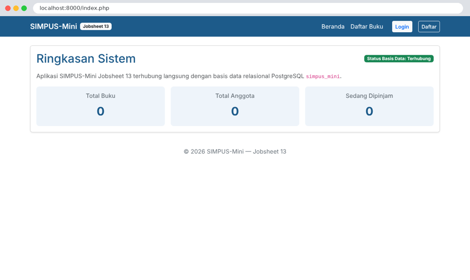

## 1. Registrasi & Login Petugas

1. Buka `http://localhost:8000/auth/register.php`, atau klik **Daftar** di kanan atas.
2. Isi **Nama Lengkap**, **Username**, dan **Password** (minimal 6 karakter), lalu klik **Daftar
   Akun Petugas**.

   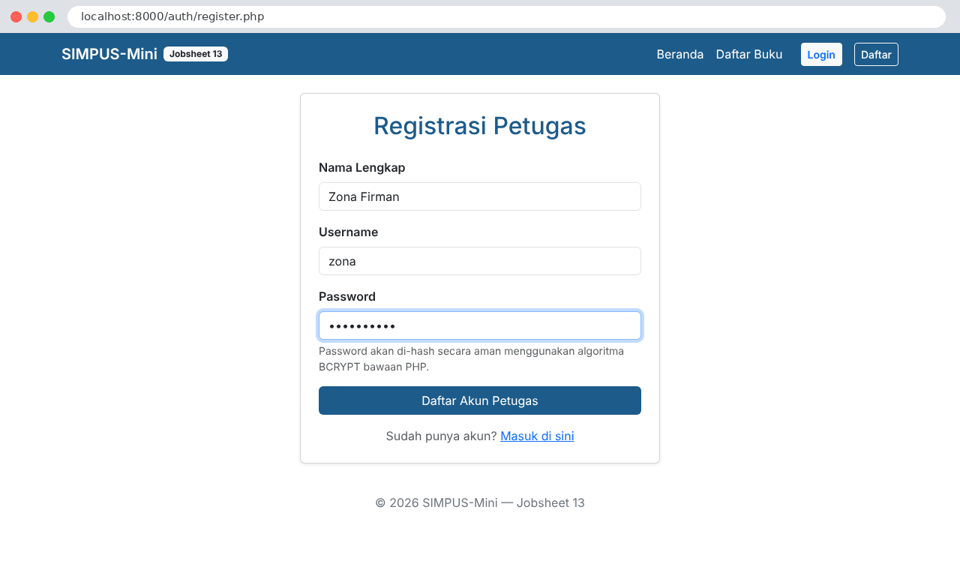

3. Setelah berhasil kamu diarahkan ke halaman Login. Masukkan username dan password yang baru
   dibuat, lalu klik **Masuk**.

   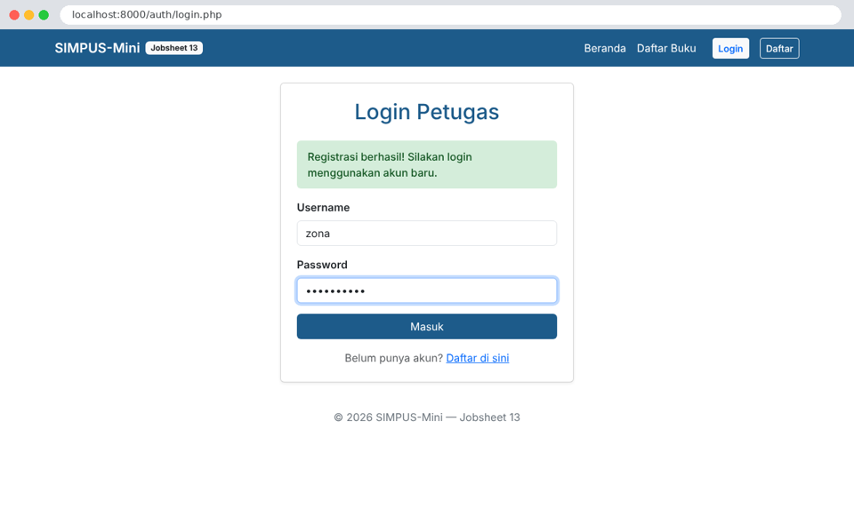

4. Setelah login, navbar menampilkan nama petugas dan tombol **Logout**, ditambah menu Tambah Buku,
   Daftar/Tambah Anggota, dan **Peminjaman** yang tidak terlihat oleh Tamu. Beranda juga menampilkan
   Aksi Cepat dan Transaksi Terbaru.

   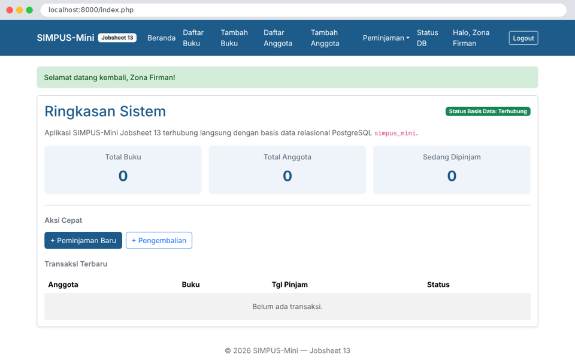

## 2. Mengelola Data Buku

1. Klik menu **Tambah Buku**, isi Judul, Pengarang, Tahun, ISBN, Stok, dan Kategori, lalu klik
   **Simpan**.

   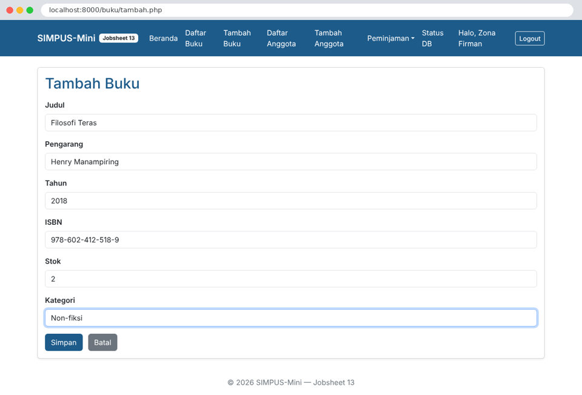

2. Buku baru langsung tampil di **Daftar Buku**.

   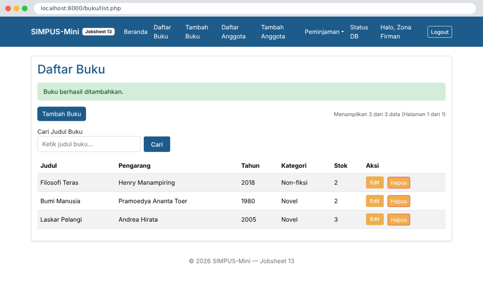

3. Untuk mencari buku, ketik sebagian judul di kolom **Cari Judul Buku** lalu klik **Cari**. Klik
   **Reset** untuk menampilkan semua buku lagi.

   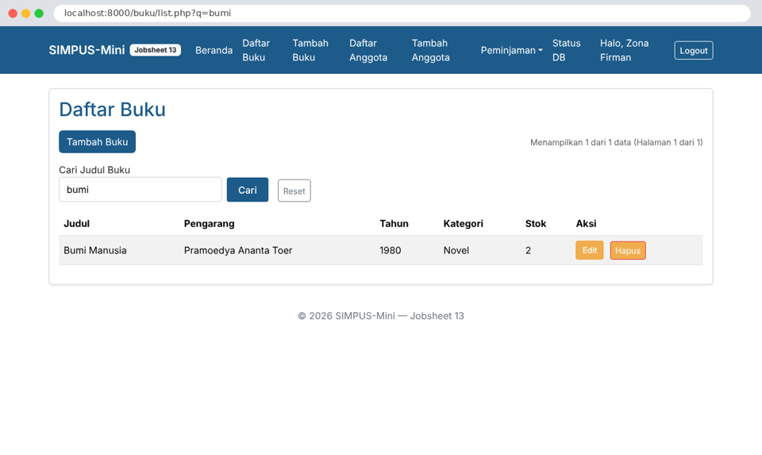

4. Klik **Edit** pada baris buku untuk mengubah datanya, lalu klik **Simpan Perubahan**.

   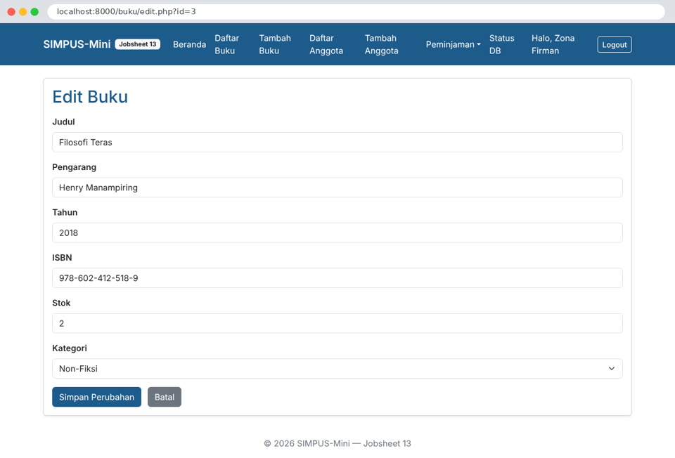

5. Klik **Hapus** untuk menghapus buku. Akan muncul konfirmasi dulu sebelum data benar-benar
   dihapus. Buku yang sudah pernah dipinjam tidak bisa dihapus karena riwayat peminjamannya masih
   tersimpan.

## 3. Mengelola Data Anggota

Alurnya sama dengan Buku.

1. Klik menu **Tambah Anggota**, isi No. Anggota, Nama Lengkap, Alamat, dan No. HP, lalu klik
   **Simpan**.

   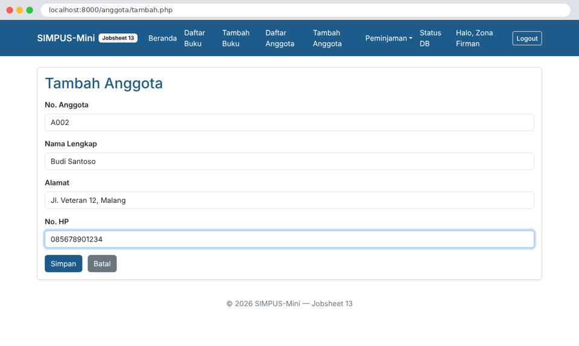

2. Anggota baru tampil di **Daftar Anggota**. Tombol Edit dan Hapus tersedia di setiap baris, dan
   pencarian bisa memakai nama atau nomor anggota.

   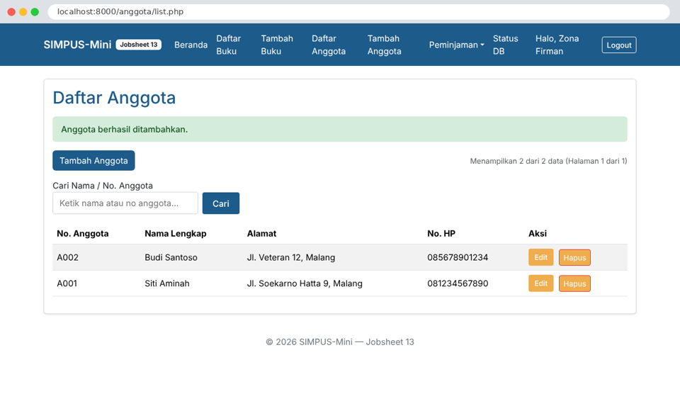

## 4. Meminjamkan Buku

1. Klik menu **Peminjaman** lalu pilih **Peminjaman Baru** (atau tombol **+ Peminjaman Baru** di
   Beranda).
2. Pilih **Anggota** dan **Buku**, lalu klik **Simpan Peminjaman**. Hanya buku yang stoknya masih
   ada yang muncul di pilihan. Tanggal pinjam terisi otomatis dengan tanggal hari ini.

   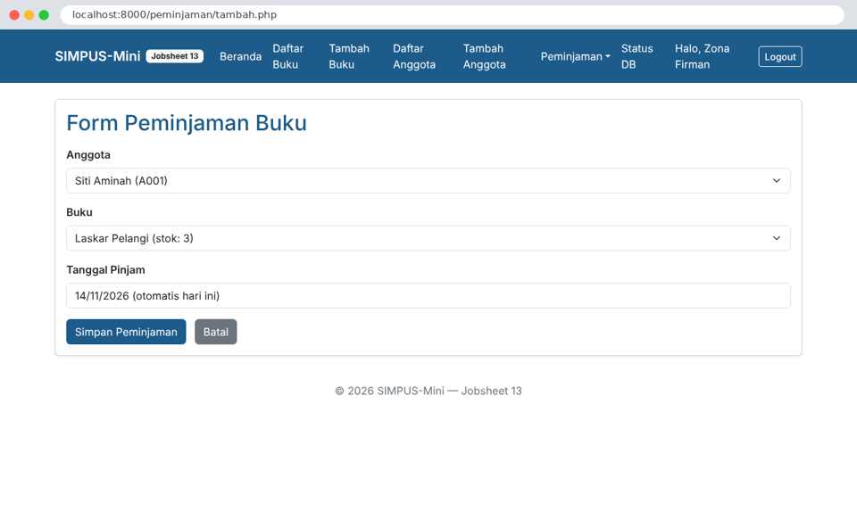

3. Kamu kembali ke **Beranda**: muncul pesan "Peminjaman berhasil dicatat.", kartu **Sedang
   Dipinjam** bertambah, dan transaksi tampil di Transaksi Terbaru.

   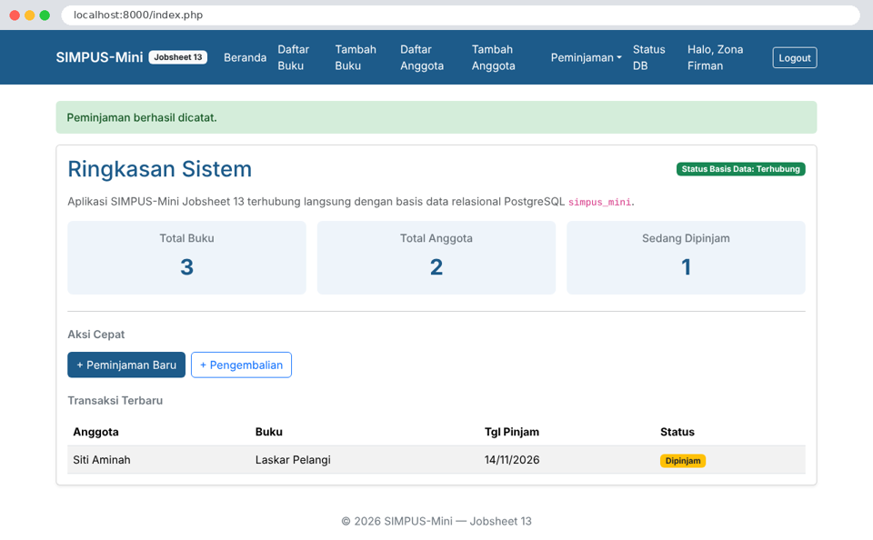

4. Di **Daftar Buku**, stok buku yang dipinjam berkurang 1.

   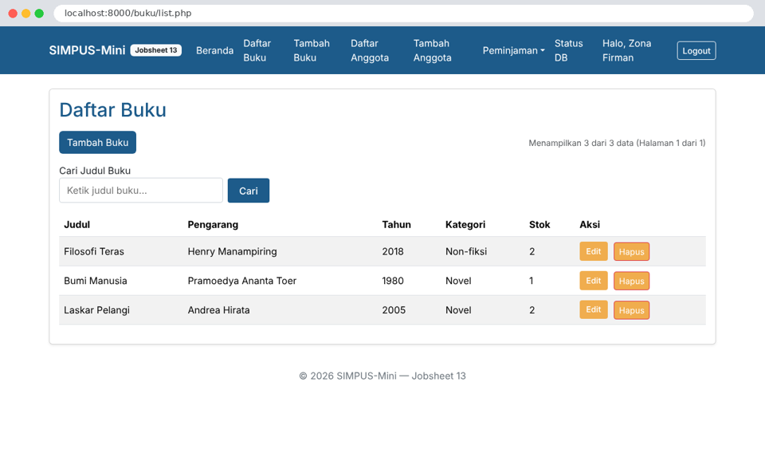

Catatan: anggota yang masih membawa buku lebih dari 14 hari tidak bisa meminjam buku baru sampai
buku itu dikembalikan.

## 5. Mengembalikan Buku

1. Klik menu **Peminjaman** lalu pilih **Pengembalian**.
2. Daftar berisi semua buku yang sedang dipinjam beserta tanggal jatuh temponya (14 hari setelah
   tanggal pinjam). Transaksi yang sudah lewat jatuh tempo diberi label **Terlambat**.
3. Kalau daftarnya panjang, cari berdasarkan nama anggota atau judul buku, lalu klik **Kembalikan**
   pada baris yang sesuai.

   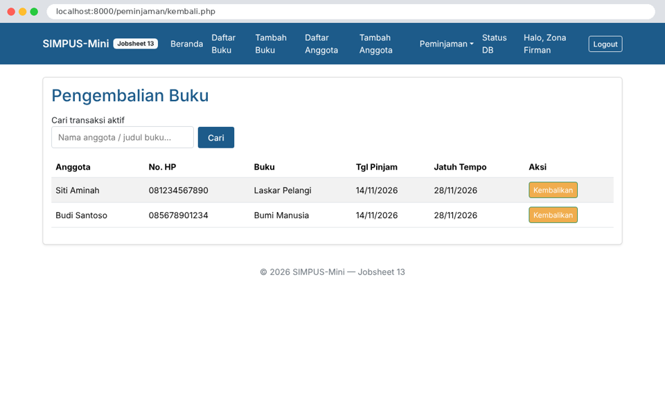

4. Muncul pesan "Buku berhasil dikembalikan.", transaksi hilang dari daftar, dan stok buku bertambah
   lagi 1.

   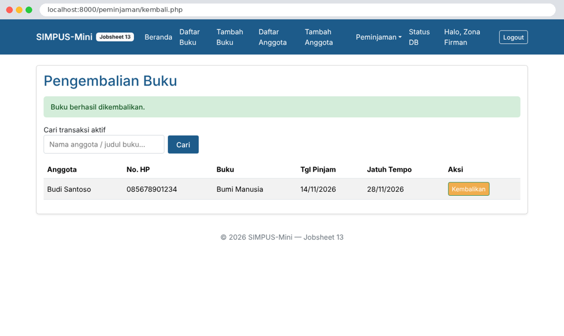

## 6. Melihat Riwayat Peminjaman

1. Klik menu **Peminjaman** lalu pilih **Riwayat**.
2. Pilih nama anggota dari dropdown, lalu klik **Tampilkan**.
3. Tabel menampilkan semua peminjaman anggota tersebut beserta tanggal pinjam, tanggal kembali, dan
   status (**Dipinjam** atau **Selesai**).

   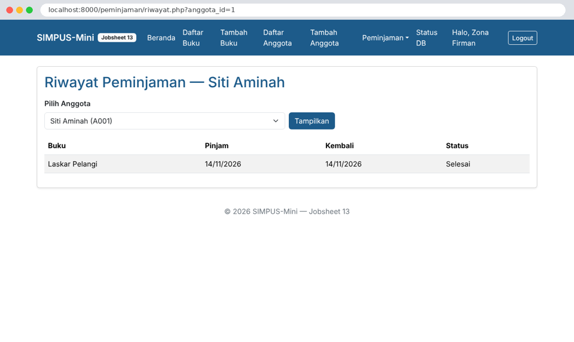

## 7. Logout

Klik **Logout** di kanan atas navbar untuk mengakhiri sesi. Setelah logout, menu yang butuh login
(Tambah Buku, Anggota, Peminjaman) hilang dari navbar.

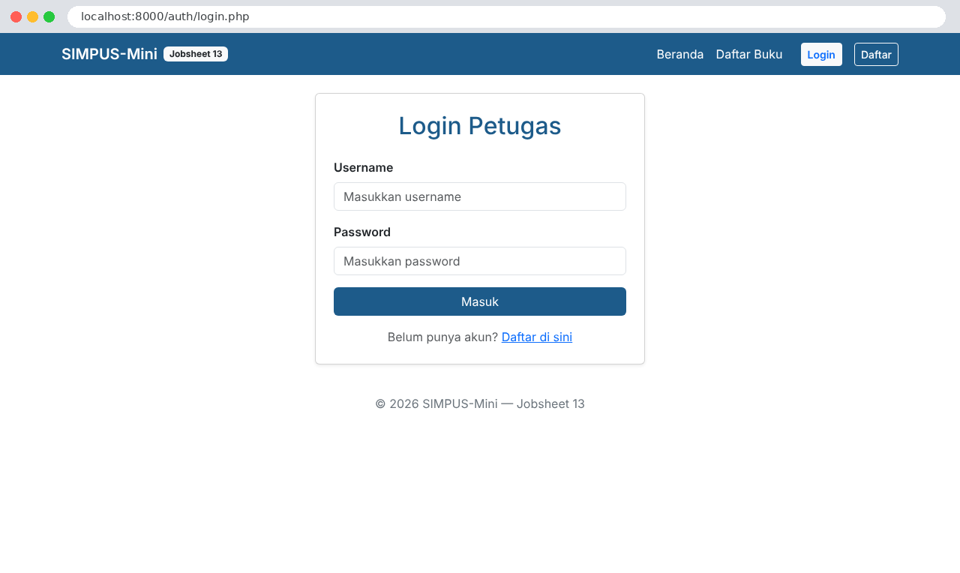

Halaman-halaman itu juga tidak bisa dibuka langsung lewat alamatnya. Misalnya membuka
`http://localhost:8000/peminjaman/tambah.php` tanpa login akan otomatis diarahkan ke halaman Login.

